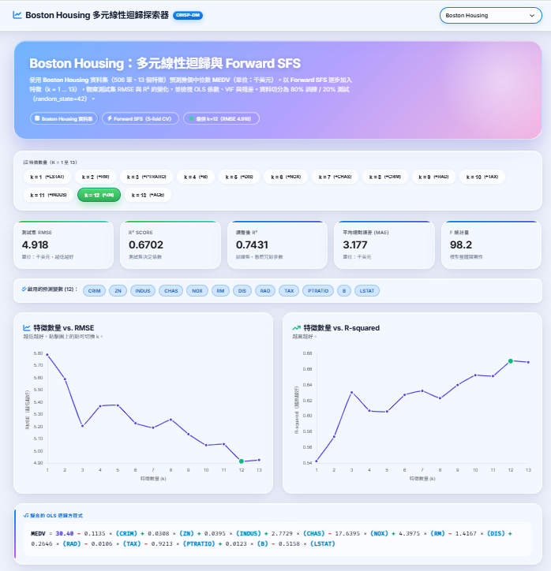
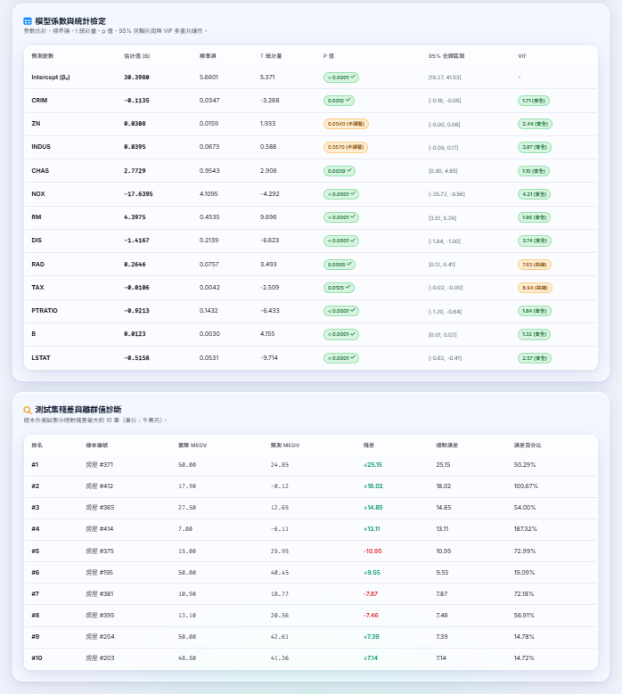

# 50 Startups：多元線性迴歸與特徵選擇探索器

一個結合機器學習、統計推論與全端網頁的互動式平台，使用 **Flask** 框架，並遵循 **CRISP-DM**（跨產業資料探勘標準流程）方法論。

本專案以 **Multiple Linear Regression (OLS)** 對比 **5 種特徵選擇演算法**，找出預測新創公司利潤的最佳特徵子集，同時避免多重共線性（multicollinearity）與過擬合（overfitting）。

網頁提供三種資料來源，可由頁首的下拉選單切換：

| 下拉選單項目 | 說明 |
| :--- | :--- |
| **50 Startups** | 預先計算的 5 種特徵選擇演算法比較（本專案主體） |
| **Boston Housing** | 以 Forward SFS 逐步加入 13 個特徵，預測房價中位數 `MEDV` |
| **自訂資料集** | 輸入任意 CSV 網址或上傳檔案，在瀏覽器內即時執行 OLS 與 Forward SFS |

---

## 🌐 線上展示與互動式網頁應用

🐙 **GitHub Repository**：**[https://github.com/PecoRun/AIoT-DIC2-MultipleLR](https://github.com/PecoRun/AIoT-DIC2-MultipleLR)**  
🔗 **Live Demo**：**[https://pecorun.github.io/AIoT-DIC2-MultipleLR/](https://pecorun.github.io/AIoT-DIC2-MultipleLR/)**




網頁版面風格參考 [StatsUnlock](https://statsunlock.com/multiple-linear-regression-calculator/) 的專業 SaaS 統計計算器。

### 本機以 Flask 執行

1. **安裝相依套件**：
   ```bash
   pip install -r requirements.txt
   ```

2. **啟動 Flask 應用程式**：
   ```bash
   python app.py
   ```
   開啟瀏覽器前往：**[http://localhost:5000/](http://localhost:5000/)**

> 💡 「自訂資料集」的計算全部在瀏覽器內完成，因此 GitHub Pages 與 Vercel 等純靜態環境也能使用，不需要 Flask 後端。

### Flask REST API 端點

- `GET /`：顯示主要的互動式迴歸探索器。
- `GET /api/models`：回傳 5 種演算法的完整評估資料（$k=1 \dots 5$）。
- `POST /api/predict`：即時推論端點，計算預測利潤與公式貢獻明細：
  ```json
  {
    "algo": "Lasso",
    "k": 2,
    "rd_spend": 100000,
    "marketing_spend": 150000,
    "admin_spend": 120000,
    "state": "California"
  }
  ```
- `GET /api/summary`：回傳所有演算法的摘要指標。

---

## ✨ 網頁功能

### 50 Startups
- **演算法切換**：可在 Lasso (L1)、Forward SFS、RFE、ElasticNet、Exhaustive Search 之間切換，或選擇**同時比較全部 5 種方法**。
- **特徵數量按鈕（$k=1 \dots 5$）**：即時觀察不同子集大小下的模型指標與方程式。
- **雙面板互動圖表**：以 Chart.js 呈現「特徵數量 vs. RMSE」與「特徵數量 vs. R-squared」，並標示甜蜜點與提示框。
- **動態迴歸方程式**：隨預測變數增減即時更新公式。
- **StatsUnlock 風格係數表**：完整推論統計，包含 $\beta$ 係數、標準誤（Standard Error）、$t$ 值、$p$ 值、95% 信賴區間與 VIF（Variance Inflation Factor）。
- **即時利潤預測器**：以滑桿調整 R&D Spend、Administration、Marketing Spend 與 State，立即計算預測利潤。
- **前 10 大離群值與殘差診斷表**：針對樣本外測試集的殘差分析。

### Boston Housing
- 使用 Boston Housing 資料集（506 筆、13 個特徵）預測 `MEDV`（房價中位數，單位千美元）。
- 以 **Forward SFS**（5-fold CV）逐步加入特徵，k = 1 … 13；資料切分為 80% 訓練 / 20% 測試（`random_state=42`）。
- 提供 RMSE、R²、調整後 R²、MAE、F 統計量、OLS 方程式、係數表（含 VIF）與前 10 大殘差。
- 測試集 RMSE 最低在 **k=12**（RMSE ≈ 4.918，R² ≈ 0.6702）。

### 自訂資料集（加分題）
- **輸入方式**：貼上 CSV 網址（例如 [50_Startups.csv](https://raw.githubusercontent.com/Avik-Jain/100-Days-Of-ML-Code/master/datasets/50_Startups.csv)），或直接上傳 CSV 檔案。
- **目標欄位 (y)**：載入後可由下拉選單選擇，預設為最後一欄。
- **自動資料處理**：
  - 文字類別欄位轉為虛擬變數（dummy variables），並去除一個參考組；
  - 略過編號欄位（如 `id`、`index`）、常數欄位與類別數過多的欄位；
  - 刪除含缺失值的資料列，並在狀態列說明處理結果。
- **計算內容**：OLS 完整統計量（係數、標準誤、$t$ 值、$p$ 值、95% 信賴區間、VIF、R²、調整後 R²、F 檢定）與 Forward SFS（5-fold CV）。
- **隨機切分**：seed = 42，80% 訓練 / 20% 測試。因此同一份資料的測試集 RMSE 會與預先計算（sklearn 切分）的結果略有不同，這是切分造成的差異。
- **正確性驗證**：引擎的係數、標準誤、$t$ 值、$p$ 值、信賴區間、VIF、F 檢定已與 statsmodels 比對，結果一致。
- **使用限制**：
  - 特徵數（含虛擬變數）≤ 40，資料列 ≤ 20,000；
  - 以網址載入時，對方伺服器必須允許跨來源存取（CORS）；`raw.githubusercontent.com` 可用，若失敗請改用上傳檔案；
  - 目前只實作 OLS 與 Forward SFS，Lasso、RFE、ElasticNet、Exhaustive Search 尚未加入。

---

## 📊 核心實證發現（50 Startups）

### 1. 2 個特徵的甜蜜點（$k=2$）
在全部 5 種特徵選擇演算法中，模型一致收斂到 **`['R&D Spend', 'Marketing Spend']`** 作為最佳子集：
- **最低測試集 RMSE**：**`$8,198.80`**（所有測試模型中誤差最低）
- **最高測試集 $R^2$**：**`0.9474`**（解釋 94.74% 的新創公司利潤變異）
- **R&D 的主導地位**：僅 R&D Spend 就能解釋超過 $94.6\%$ 的利潤變異（$k=1$：$R^2 = 0.9465$，$\text{RMSE} = \$8,274.87$）。加入 Marketing Spend 後提供互補的正向預測增益。

### 2. 5 個特徵的過擬合懸崖（$k=5$）
加入冗餘變數（`Administration` 以及地區虛擬變數 `State_Florida`、`State_New York`）會引入雜訊與多重共線性：
- **測試集 RMSE 上升**：從 **`$8,198.80`** 增加到 **`$9,137.99`**（多出 $939 的懲罰！）
- **$R^2$ 下降**：降至 **`0.9347`**
- **簡約原則（Occam's Razor）**：較簡單的 2 變數模型在預測準確度、可解釋性與泛化能力上，都優於完整的 5 變數模型。

---

## 🔬 5 種特徵選擇演算法比較

5 種方法皆在樣本外測試集上，針對 $k=1 \dots 5$ 個特徵進行基準比較：

| 特徵選擇演算法 | $k=1$ (RMSE) | $k=2$ (RMSE) | $k=3$ (RMSE) | $k=4$ (RMSE) | $k=5$ (RMSE) | 最佳特徵子集 |
| :--- | :---: | :---: | :---: | :---: | :---: | :--- |
| **Lasso (L1 Ranking)** | $8,274.87 | **$8,198.80** | $8,309.06 | $8,409.92 | $9,137.99 | `['R&D Spend', 'Marketing Spend']` |
| **Forward SFS** | $8,274.87 | **$8,198.80** | $8,803.78 | $8,997.20 | $9,137.99 | `['R&D Spend', 'Marketing Spend']` |
| **RFE** | $8,274.87 | **$8,198.80** | $8,803.78 | $9,068.54 | $9,137.99 | `['R&D Spend', 'Marketing Spend']` |
| **ElasticNet Ranking** | $8,274.87 | **$8,198.80** | $8,803.78 | $8,997.20 | $9,137.99 | `['R&D Spend', 'Marketing Spend']` |
| **Exhaustive (Best Subset)** | $8,274.87 | $8,198.80 | **$8,171.65** | $8,178.37 | $9,137.99 | `['R&D Spend', 'Admin', 'State_FL']` |

---

## 📁 專案結構

```text
├── app.py                              # Flask 網頁應用程式（WSGI 進入點與 REST API）
├── api/
│   └── index.py                        # Vercel Serverless Function 進入點
├── templates/
│   └── index.html                      # StatsUnlock 風格的 Jinja2 網頁模板（含三種資料來源與計算引擎）
├── index.html                          # GitHub Pages 使用的靜態版頁面
├── static/
│   ├── model_data.js                   # 50 Startups 靜態資料（前端備援）
│   └── boston_data.js                  # Boston Housing 靜態資料
├── model_data.json                     # 50 Startups 的完整模型統計、權重與檢定結果
├── model_data.js                       # 50 Startups 資料（GitHub Pages 版使用）
├── boston_data.js                      # Boston Housing 的 Forward SFS 結果
├── boston_analysis.py                  # 產生 boston_data.js 的分析腳本
├── main.py                             # CRISP-DM 命令列多元線性迴歸腳本
├── feature_progression_analysis.py     # 產生 k=1..5 指標與圖表的腳本
├── all_5_algorithms_comparison_plot.png# 5 種演算法比較圖
├── dashboard_demo.png                  # README 使用的儀表板截圖
├── vercel.json                         # Vercel 部署設定
├── requirements.txt                    # 專案相依套件（Flask、NumPy、Pandas 等）
└── README.md                           # 專案說明文件
```

### 重新產生 Boston Housing 資料

```bash
python boston_analysis.py
```
腳本會透過 OpenML 下載資料（需連網），執行 Forward SFS 後輸出 `boston_data.js`。若要讓 Flask 版載入新結果，請同步複製到 `static/boston_data.js`。

---

## ☁️ 部署

### 1. GitHub Pages（啟用中）
🔗 **[https://pecorun.github.io/AIoT-DIC2-MultipleLR/](https://pecorun.github.io/AIoT-DIC2-MultipleLR/)**  
透過 `.github/workflows/pages.yml` 自動部署。

### 2. Vercel
透過 `api/index.py` 與 `vercel.json` 設定，可零設定部署為 Vercel Python Serverless 應用。

---

## 🙏 致謝與參考資料

感謝以下參考資料、資料集與開源工具：

1. **設計與版面參考**：
   - [StatsUnlock Multiple Linear Regression Calculator](https://statsunlock.com/multiple-linear-regression-calculator/)：啟發了 SaaS 風格、係數表、VIF 多重共線性指標與統計報告版面。
2. **資料集**：
   - [50 Startups Dataset（Avik Jain 100-Days-Of-ML-Code）](https://raw.githubusercontent.com/Avik-Jain/100-Days-Of-ML-Code/master/datasets/50_Startups.csv)。
   - Boston Housing Dataset（透過 [OpenML](https://www.openml.org/) 取得）。
3. **核心函式庫**：
   - [Flask](https://flask.palletsprojects.com/)：Python 微型網頁框架。
   - [Scikit-learn](https://scikit-learn.org/)：提供 LassoCV、ElasticNetCV、SequentialFeatureSelector 與 RFE。
   - [Statsmodels](https://www.statsmodels.org/)：提供 OLS 推論、$t$ 檢定、$p$ 值、信賴區間與 VIF 計算。
   - [Chart.js](https://www.chartjs.org/)：響應式互動雙面板折線圖。
